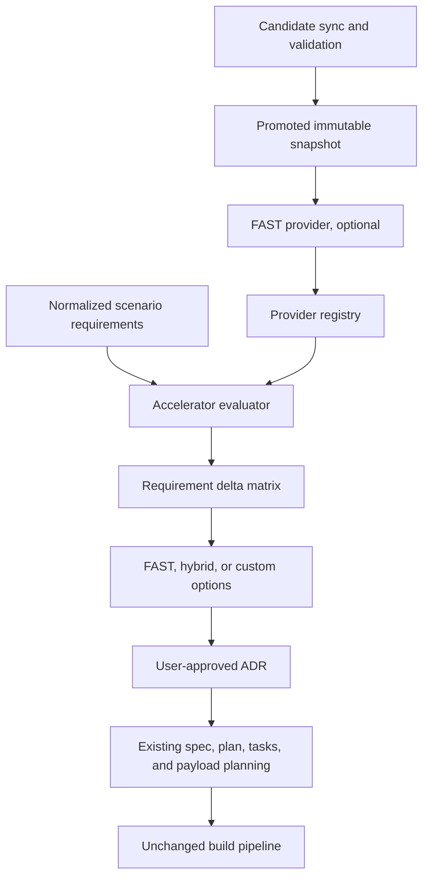

# FAST Solution Accelerator Discovery - Current Architecture Assessment

**Phase:** FAST-001  
**Status:** Proposed for architectural review  
**Baseline:** `17bebe3fb2322c2ad07c05dec8ef0c64dba6df28`

## Current workflow

The repository has one shared model-driven-app workflow with three discovery
modes. Mode selection changes intake depth but not the planning artifacts or
execution pipeline.


## Existing extension points

| Concern | Current implementation | FAST implication |
| --- | --- | --- |
| Mode contract | `wizard.profile.json`, `docs/wizard-contract-v1.md`, and mode parity tests | Preserve exactly three modes. FAST matching must be an optional post-discovery service, not a fourth mode. |
| Discovery | `scripts/bootstrap/05-start-wizard.ps1` collects requirements and emits shared planning artifacts without Dataverse mutation | Insert future evaluation after requirements normalization and before final architecture confirmation. Demo Builder must not gain a mandatory question. |
| Planning gate | `spec.md`, `plan.md`, and `tasks.md` are required by `90-run-build.ps1`; `15-dry-validate.ps1` and `Test-WizardBuildContract` validate planning and payload contracts | FAST decisions should extend scenario planning artifacts and ADRs. They must not create a parallel planning system. |
| Feature parsing | `Get-WizardFeatureConfig` reads stable Markdown sections from `answers.md` | Accelerator selection should have a typed JSON contract with a human-readable Markdown projection rather than adding fragile free-text parsing. |
| Payload generation | Table, column, relationship, process, reporting, data, Choice, grid, and form-layout contracts drive build stages | A selected accelerator may influence later payload planning, but discovery alone must never emit executable payloads or authorize deployment. |
| Orchestration | `90-run-build.ps1` resolves scenario paths, verifies planning files, computes enabled optional stages, persists run state, and supports Preview/Apply | FAST-001 does not register a stage. Future FAST-dependent execution must be gated before existing Dataverse stages and remain absent when disabled. |
| Dataverse transport | `helpers/dataverse-runtime.ps1` centralizes preview non-mutation, token refresh, retry/backoff, secret redaction, and scoped publishing | Future package/environment verification should reuse this boundary. Catalog crawling must use a separate allowlisted HTTP client because it is not Dataverse traffic. |
| Artifact provenance | `helpers/wizard-hardening.ps1` stores scenario-scoped manifests and validates scenario, solution, and publisher identity | Add a separate immutable catalog snapshot manifest, then reference its ID and hashes from scenario decisions and existing run evidence. Do not mix remote catalog content into generated-artifact ownership. |
| Idempotency | Script 85 compares stable IDs and action outcomes; script 95 verifies exact unpacked solution membership | FAST selections must pin provider, snapshot, module versions, and evidence hashes so reruns cannot silently change architecture. |
| Validation | Contract integrity, schema, mode, preview non-mutation, hardening, idempotency, and source-control tests are credential-free | Add provider fixtures, catalog-schema tests, promotion/rollback tests, matching golden cases, and disabled/offline parity tests before runtime registration. |
| Source control | Scenario branches, checkpoints, validation before commit, approval before push, and remote verification are defined in the profile | FAST work remains on `feature/fast-accelerator-catalog` and should be split into the milestones in the implementation directive. |

## Current operating modes

### Demo Builder

- Six business questions and one consolidated recommendation confirmation.
- Technical design is inferred.
- FAST matching must be invisible unless a credible recommendation exists.
- At most one concise FAST/Hybrid versus Custom choice may be added in a future
  contract change, and only after matching.

### Advanced Builder

- Explicit architecture, entity mapping, user tasks, relationships, reports,
  demo data, and source-control controls.
- Future FAST detail can be an expandable evaluation artifact with module,
  dependency, evidence, freshness, compatibility, and override information.
- Existing question semantics must remain intact.

### Framework Acceptance

- Adds isolation, authorized-environment, deterministic rerun, retention,
  cleanup, and evidence controls.
- Future acceptance must exercise catalog sync, snapshot promotion, matching,
  dependency ordering, disabled/offline behavior, and rollback without
  changing normal production data.

## Existing safeguards to retain

1. Planning is mandatory before build scripts.
2. Payload files remain the executable schema source of truth.
3. Preview cannot create provenance or invoke mutation.
4. Scenario, solution, and publisher identity mismatches stop execution.
5. Existing forms and standard tables are not modified without explicit
   strategy.
6. Solution membership and exact IDs are verified before export.
7. Authentication, Dataverse mutation, and publishing remain in established
   runtime helpers.
8. Framework Acceptance destructive cleanup requires separate approval.

## Missing capabilities

The repository currently has no:

- accelerator-provider interface or registry;
- FAST-specific source adapter;
- allowlisted crawler or structured-source ingestion layer;
- candidate/promoted catalog snapshot store;
- catalog schema, diff, tombstone, or promotion workflow;
- reusable official module-page release-link discovery;
- reusable offline solution-package metadata indexing (the Core correction
  proves feasibility but is evidence, not a runtime implementation);
- search or semantic retrieval index;
- module dependency graph;
- conceptual/package/environment evidence-tier model;
- requirements-to-accelerator matching engine;
- per-requirement reuse/extend/build/integrate/verify matrix;
- accelerator selection ADR generator;
- FAST capability flag;
- FAST disabled, missing-provider, outage, or retirement tests.

These are FAST-002 and later implementation concerns. FAST-001 defines their
contracts only.

## Proposed boundary



The base wizard depends only on provider-neutral contracts. The optional FAST
assembly depends on those contracts and can be omitted without consumer code
changes. Synchronization and matching are read-only planning capabilities.
Dataverse inspection or package installation remains separately authorized.

## Recommended repository locations for later phases

These names are planning targets and are not created in FAST-001:

```text
schemas/accelerators/
  accelerator-catalog.schema.json
  accelerator-decision.schema.json
  accelerator-snapshot-manifest.schema.json

scripts/accelerators/
  providers/
  sync/
  validation/
  matching/

catalog/fast/
  snapshots/
  fixtures/

specs/<scenario-slug>/
  accelerator-evaluation.json
  requirements-to-accelerator-matrix.md
  ADR-accelerator-selection.md
```

Generated live snapshots should not be committed automatically. Reviewed
fixtures and schemas may be committed; operational snapshots and candidate
content require an explicit retention and licensing decision.

## Assessment conclusion

The wizard can support FAST without redesigning its working screens or build
stages. The safest seam is between normalized discovery and final architecture
confirmation, backed by provider-neutral contracts and immutable catalog
snapshots. No existing script or contract needs to change during FAST-001.
